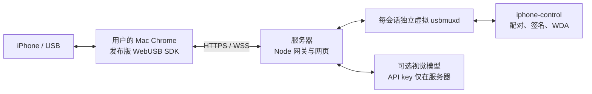

# Mac Chrome iPhone 控制台

在自己的 Mac 上插入 iPhone，用 Chrome 授权 USB，再从网页发起手动操作或自然语言任务。浏览器负责真实 USB 数据转发，服务器运行现有 iphone-control 原生引擎、WDA 准备和可选 AI。生产环境由同一 HTTPS origin 提供网页、REST API 和 WebSocket。



网页必须保持打开。所选 iPhone 拔出 USB 时，页面会立即显示断开并关闭对应 WebSocket 与会话；其他设备的拔出事件不会影响当前会话。部署后的用户 Mac 无需额外安装原生 helper；服务器必须安装原生引擎。仅部署静态网页不能提供手机控制。把服务器在本机启动，是开发时模拟云端角色，不能据此称为已部署云服务。

## 本地开发

需要 Node 22.13+、Mac Chrome，以及服务器侧可执行的 `iphone-control`。当前源码基于 0.1.4，包含 Apple 登录连接复用和网页管道输入的兼容补丁。使用 Rust 1.88+ 在仓库根目录执行 `cargo build --release -p iphone-control`，将 `ICTL_BIN` 指向生成的 `target/release/iphone-control`。然后从仓库根目录执行：

```bash
cd browser-control
npm ci
cp .env.example .env
# 编辑 .env：替换 CONTROL_ACCESS_TOKEN，并设置 ICTL_BIN 为原生二进制路径
npm run build
npm start
```

打开 [http://127.0.0.1:8787](http://127.0.0.1:8787)，在页面粘贴服务器访问令牌并点击「连接 iPhone」。令牌仅在本页内存中使用。首次连接需要解锁手机、信任电脑，并根据原生向导完成开发者模式、Apple 账号与 WDA 签名。

前端热更新可另开终端运行 `npm run web:dev`，访问 [http://127.0.0.1:5173](http://127.0.0.1:5173)。Vite 将 `/api` 与 `/ios` 代理至 `127.0.0.1:8787`；页面服务器地址留空即可。`.env.example` 包含这两个开发 origin。`npm start` 和 `npm run dev` 都用 Node `--env-file-if-exists=.env` 读取当前目录的环境文件。更改前端后，生产入口需要重新 `npm run build`。

```bash
npm test
npm run typecheck
npm run build
```

测试包含真实 HTTP/WebSocket/TCP/Unix Socket 和原生 CLI fixture，也包含发布版 SDK 的 `requestUSBAccess → pairDevice` 集成：一个明确标注的假 USB peer 回应 usbmux 版本握手，用假原生控制器与真实网关验证接口回退、恢复配对、关闭和删除会话。它没有模拟物理 iPhone、Apple 登录、Lockdown 授权或 WDA 控制成功。

## 页面行为

空白设备框表示尚无真实截图。Chrome 点击事件会立即调用 SDK 的 USB chooser，再读取 IndexedDB 配对记录、创建服务端会话并配对。原始现代 USB serial 统一转成 8-16 UDID，命令使用创建接口返回的 `deviceId`。发布版 SDK 负责候选配置遍历、接口申请、usbmux 通信和配对。接入层增加两处传输适配，服务器按 USB 单包发送上限拆分 StreamData，浏览器按长度头组装完整接收包并保留后续包。原生 WebUSB getter 和方法绑定回真实 USBDevice，USB 断开监听保留原始设备引用。

`GET /api/sessions/:id` 的 `ready` 只表示原生 JSON 控制通道就绪。页面检查 `daemon.state.state === 'ready'` 后才启用 WDA 手动控制和 AI 任务。AI 未配置时仍可手动控制。手机截图的 JPEG 像素已由原生引擎换算为点击点，页面按图片实际尺寸与留白换算点按、滑动和长按，最长 10 秒。

配对期间会继续读取设备准备输出。只在原生向导提示时提交单行账号、密码或验证码；输入提交前立即清空。账号和签名由所配置服务器处理，浏览器不发送模型 API key。配对记录由 SDK 存入 IndexedDB；原生账号与签名资料保留在服务器隔离的运行目录中，重连可恢复。

取消连接会立即显示离线并禁用设备控制。若 SDK 配对或 USB 释放尚未结束，页面显示「等待 USB 释放」并暂时禁用重连，避免旧配对清理关闭新连接的同一 USB 设备。请等待处理结束；长时间未结束时，可刷新页面后重试。服务端 DELETE 等待最多 5 秒，但这个时限不会解除仍在进行的 SDK 配对或 USB 释放。

AI 任务执行期间暂停手动操作。确认框显示具体操作、参数和原因；拒绝即停止任务。停止会阻止后续步骤，停止前已送出的操作可能仍已执行。动作、任务创建、确认和准备输入都不自动重试，超时后应查看手机再决定下一次操作。

## 环境变量

| 变量 | 用途 |
|---|---|
| `CONTROL_ACCESS_TOKEN` | 必填，创建会话的服务器访问令牌；使用长随机值 |
| `ALLOWED_ORIGINS` | 逗号分隔的完整允许 origin，包含协议和端口；部署时只填写实际 HTTPS 网站 |
| `HOST` | Node HTTP 监听地址，默认 `127.0.0.1`；容器内为 `0.0.0.0` |
| `PORT` | HTTP 与 WebSocket 共用端口，默认 `8787` |
| `RUNTIME_DIR` | 每会话原生数据和配对恢复索引目录，默认 `.runtime` |
| `PUBLIC_BASE_URL` | 反向代理外部 HTTP(S) origin，决定返回的 ws/wss relay 地址 |
| `ICTL_BIN` | 从当前源码构建的 `iphone-control` 可执行路径 |
| `LLM_BASE_URL` | 可选模型兼容 API 根地址，如 `https://provider.example/v1`，不含账号、query 或 fragment |
| `LLM_MODEL` | 可选支持截图输入的模型名称 |
| `LLM_API_KEY` | 可选模型 key，仅配置于服务器环境 |

模型三个变量缺一即为未配置。当前客户端向 `/chat/completions` 发送视觉 Chat Completions 请求，使用 `temperature: 0`、`max_tokens: 1024`，要求模型返回校验后的纯 JSON 操作或完成消息。它不使用 function tools。服务商必须兼容图片输入、这些请求参数与响应格式；已配置只表示配置完整，不能证明服务商健康。o-series 等需要不同 token/temperature 参数的模型仍需后续适配，当前没有宣称通用模型兼容性或真实模型评测。

## Linux 部署

Dockerfile 复用 `ghcr.io/derrors/iphone-control:0.1.4` 的原生二进制、Appium 未签名 WDA、资源和许可证，在 Debian Trixie/glibc 兼容的 Node 22 运行时运行网关。服务端没有 USB 设备挂载，也不需要 privileged 或系统 usbmuxd；USB 在用户 Mac 浏览器中，通过 WSS 转发到各会话的虚拟 mux。服务器需要能访问 Apple、签名相关服务、设备支持资源以及模型服务商。

在 `browser-control/.env` 中填写部署值，例如网站 origin `https://phone.example.com`；将 `ALLOWED_ORIGINS` 与 `PUBLIC_BASE_URL` 都设置成这个 origin。不要把真实凭证写入 Dockerfile 或镜像。然后：

```bash
cd browser-control
docker compose up -d --build
```

Compose 只在服务器回环地址公开 `8787`，让 HTTPS 代理转发。一个 Caddy 配置示例：

```caddyfile
phone.example.com {
    reverse_proxy 127.0.0.1:8787
}
```

把示例域名换成实际域名并配置 DNS；Caddy 自动处理 HTTPS 与 WebSocket upgrade。此示例不启用访问日志。若使用其他代理或启用日志，必须移除 `/ios/device/ws` 的 query：SDK 按协议在 URL 中携带短期会话 token。不要将 Authorization、准备输入或带 token 的 URL 写入代理/请求日志。单独的前端 origin 需要配置 CORS 与 WebSocket origin，首版部署建议同 origin。

`signing-state` 卷保留原生账号和签名材料，应按敏感数据管理访问和备份；运行目录与索引使用 owner-only 权限。关闭会话会终止其拥有的原生进程组并释放临时 socket，保留签名恢复资料。一个运行目录由一个网关进程独占；多实例共享卷前需要额外分布式租约。删除卷会丢失恢复资料，轮换控制令牌也会改变恢复索引键。

本次开发宿主机没有 Docker CLI，Dockerfile 与 Compose 尚未实机构建或运行；Node 测试、类型检查与 Vite 构建不等同于容器验证。原生依赖的说明和许可证见 [THIRD_PARTY.md](THIRD_PARTY.md) 与仓库原有 [第三方声明](../THIRD_PARTY.md)。

## 真机验收与已知证据

支持目标是用户 Mac 的 Chrome。WebUSB 需要 HTTPS 或可信 localhost，Safari/Firefox 不支持。浏览器保留设备授权不等于取得 usbmux 接口访问权；SDK 接口失败应在页面显示原始失败原因并清理会话。

当前已观察到真实连接设备为 `iPhone18,3`、iOS `26.5.2`，Chrome chooser 能选到设备。一次当前 USB 配置的手动首候选探测返回 `Unable to claim interface`，进一步只读兼容诊断验证另一组已有 usbmux 配置能成功 claim，没有停止 Mac 系统服务。这只证明配置选择与接口访问；完整的配对、云端原生 WDA 和真实 AI 操作仍须分别验收。开发时 localhost 服务不算部署后的云端服务，测试假 peer 不算真实手机证据。

- [ ] 真实 Mac Chrome 由点击打开 chooser，允许/取消都正确处理。
- [ ] 成功独占 USB 并通过发布版 SDK 建立 WebSocket；设备拔出后 UI 离线，原生进程与 session token 被撤销。
- [ ] 在真实手机完成 Trust、开发者模式、Apple 签名与 WDA 启动；页面明确显示 WDA 就绪。
- [ ] 截图对应真实手机，竖屏/横屏的点按、滑动、长按位置正确；Home、Lock、音量和文字输入结果可见。
- [ ] 刷新和重连能恢复 IndexedDB 配对记录与服务器签名状态，跨设备和并发会话保持隔离。
- [ ] 配置真实视觉模型后任务观察、操作和完成正确；敏感操作确认、拒绝和停止都经过真机验收。
- [ ] HTTPS 部署、容器构建、真实外部服务器链路及日志脱敏均有独立证据。
